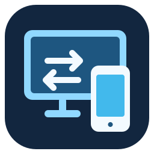
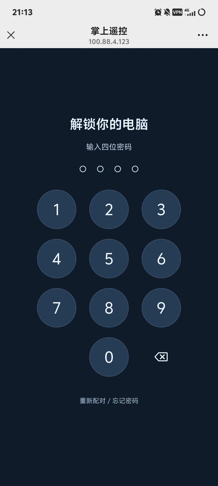
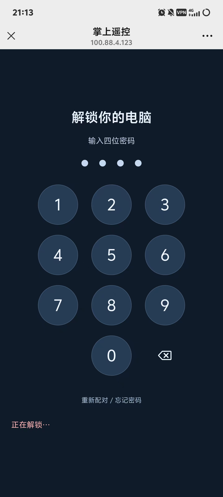
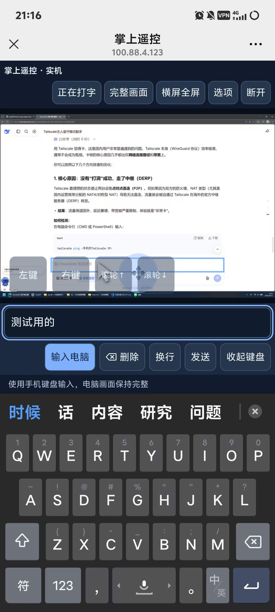
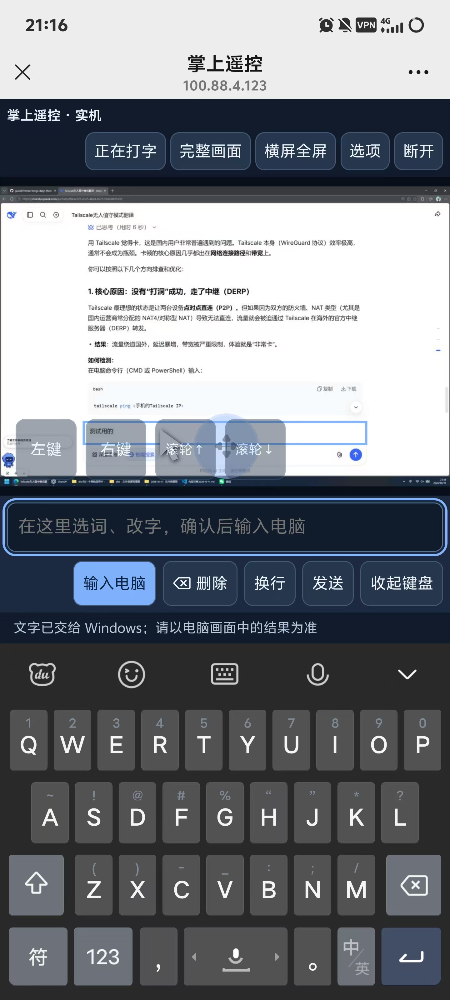

# 掌上遥控：用安卓手机控制 Windows 电脑

**简体中文** | [English](README.en.md)



电脑开着，人在别处，也能用手机查看电脑画面、移动鼠标、点击、滚动和输入中文。

手机不用安装专用遥控 App：**开启 Tailscale → 打开收藏的网址 → 输入自己的四位密码**。电脑上要先启动掌上遥控，并保持联网、不休眠、桌面已解锁。

## 我平时怎么用

第一次安装和配对完成后，每次使用只需要下面几步：

1. **电脑：**打开掌上遥控，面板显示“远控已启动”。它会尝试准备已登录的电脑 Tailscale；首次登录仍需自己完成。
2. **手机：**开启 Tailscale，确认已连接。手机可以用流量，电脑和手机不必在同一个 Wi-Fi。
3. **浏览器：**打开电脑面板给出的访问地址，输入之前设置的四位密码，等待电脑画面出现。
4. **用完：**手机点“断开”。电脑面板可以继续留着；要停止服务，在右下角托盘图标上右键，选择“退出掌上遥控”。

电脑窗口可以随时打开查看。点击窗口右上角 **×** 时，会让你选择：

- **收进托盘：**任务栏不占位置，远控继续运行；双击右下角托盘图标恢复面板。
- **最小化到任务栏：**留在底部任务栏，点击任务栏图标恢复面板。
- **取消：**继续显示面板。

直接点击最小化按钮，会留在任务栏。再次打开掌上遥控，也会恢复已经运行的面板。

## 在手机上怎么操作

| 想做什么 | 怎么操作 |
| --- | --- |
| 移动鼠标 | 右手拖动箭头旁的圆形按钮 |
| 左键、右键 | 左手点击对应按钮 |
| 选中文字或拖动窗口 | 按住“左键”不松，再用另一只手拖动圆形按钮 |
| 双击 | 连续点击两次左键 |
| 页面上下滚动 | 点“滚轮↑”或“滚轮↓”，默认慢速滚动 |
| 输入中文 | 先点击电脑上的输入框，再点“打字”，用手机自己的输入法编辑 |
| 把准备好的字输入电脑 | 点“输入电脑”；键盘会保持打开，可以继续输入 |
| 删除 | 有手机草稿时删除草稿；草稿为空时向电脑发送退格键 |
| 换行 | 点“换行”，向电脑发送 Shift＋Enter |
| 发送或提交 | 点“发送”，向电脑发送 Enter |
| 收起手机键盘 | 点“收起键盘” |
| 横着看电脑画面 | 点“横屏全屏”；“完整画面”保持整张桌面可见 |

“换行”和“发送”的最终效果，取决于电脑上目标软件的快捷键设置。“选项”里可以调整鼠标速度、画面内按钮透明度和清晰增强力度。

## 实际使用截图

下面四张图片来自实际手机使用。**图片中的地址是这次演示所用电脑的地址；你要使用自己的面板显示的网址。**

### 1. 网址刚打开：密码输入界面

这不是第一次使用，所以没有显示输入密钥与设置四位密码的界面。如果是第一次使用，网址刚打开看到的就是首次配对界面。



### 2. 密码输入好后：正在解锁，然后正在连接

输入好密码后，左下角出现“正在解锁…”的字样，然后会变成“正在连接…”的字样。



### 3. 准备给电脑网站的文本输入框输入文字

还没有输入到电脑，但文字内容已经在手机上准备好了。



### 4. 手机键盘准备好的文字成功输入电脑

手机键盘准备好的文字，成功输入到了电脑网站的文本输入框内。



## 第一次怎么搭建

目前发布的是源码，需要在自己的 Windows 电脑上完成一次安装。准备一台安卓手机、Windows 电脑，以及两边可用的网络。

### 第一步：安装基础软件

- 电脑安装 [Node.js](https://nodejs.org/) 22 或以上版本。
- 电脑和手机都安装 [Tailscale](https://tailscale.com/download)，登录同一个账号，并开启连接。
- 从本仓库右上角 **Code → Download ZIP** 下载，解压到一个准备长期保留的文件夹。

### 第二步：安装项目并启动

在解压后的项目文件夹中打开 PowerShell 或终端，运行一次：

```powershell
npm ci --ignore-scripts
```

然后双击文件夹里的 **启动手机远控.cmd**。首次会自动构建启动程序，之后就会打开掌上遥控面板，并自动启动远控服务。

以后可为生成的 **PalmRemote.exe** 创建桌面快捷方式。不要单独移动这个 exe，它需要同一文件夹里的其他文件。

### 第三步：允许自己的手机连接电脑

在手机 Tailscale 中找到**手机的 IPv4 地址**，通常以 `100.` 开头。用管理员身份打开 PowerShell，进入项目文件夹，执行下面的命令，把引号中的内容换成手机的实际地址：

```powershell
powershell.exe -NoProfile -ExecutionPolicy Bypass -File scripts/enable-external-access.ps1 -PhoneIP "手机的TailscaleIPv4地址"
```

这是一次性的电脑防火墙设置，只允许指定手机访问远控端口。它不会把电脑遥控页面开放给整个互联网。更换手机或端口后，需要重新运行。

### 第四步：手机首次配对

1. 查看电脑启动面板上的**手机访问地址**，用手机浏览器打开并收藏。
2. 点击电脑面板的**复制连接密钥**，把本机密钥输入手机首次配对页面。
3. 设置自己的四位数字密码，再输入一次确认，保存并连接。
4. 以后用同一浏览器打开同一网址，输入四位密码就能解锁，不用再输入长密钥。

**每个人的密钥和网址都不同。** 新安装会生成自己的随机密钥，重复启动保留原密钥；访问地址来自这台电脑的 Tailscale 地址和所用端口。仓库没有你的密钥或配对记录。清除浏览器数据、换浏览器或网址后，需要重新配对；忘记密码可以点“重新配对 / 忘记密码”，使用电脑长密钥重新设置。

## 这个软件是怎么做出来的

电脑端负责截取主屏幕，并把手机发来的鼠标、滚轮和文字操作交给 Windows。手机浏览器负责显示电脑画面，提供双手鼠标按钮，并调用手机自带输入法。Tailscale 负责让两台设备在不同网络下互相连接。

| 项目部分 | 做什么 |
| --- | --- |
| `web/` | 手机网页、密码键盘、鼠标按钮、文字编辑和画面显示 |
| `src/` | Node.js 服务，连接手机与电脑，校验配对并转发指令、画面 |
| `windows/Desktop.cs`、`windows/worker.ps1` | Windows 截屏与鼠标键盘操作 |
| `scripts/remote-launcher.ps1` | 电脑启动面板、托盘、启动和停止服务 |
| `windows/Launcher.cs` | 带图标的 Windows 启动入口 |

外网启动默认使用 **720p**，按原比例限制在 1280×720 内。第一次传完整画面，之后只传有变化的区域，手机保留其余背景；只移动鼠标、背景没有变化时，不重复传背景。清晰增强在手机本地处理。

这已经能操作真实 Windows 桌面，但仍是个人项目，当前只支持主屏幕和一个控制页面。电脑休眠、锁屏、UAC 或更高权限窗口不能靠它解决。

## 打不开或画面更新慢怎么办

- **网址打不开：**先确认电脑面板显示已启动，两端 Tailscale 已连接；网址使用自己的电脑地址，并检查上面那一步防火墙设置。
- **操作生效快，手机画面更新慢：**可能是画面传输带宽不足。Tailscale 能直连时通常更快；直连失败会用中继，大范围画面变化可能需要等待。网络切换后可重新测试。
- **电脑上的其他 VPN 要保持运行：**不要为了遥控直接关闭它。Tailscale 和代理可能需要分流；能否绕过付费代理，要按你的实际配置检查。
- **手机不想反复登录：**使用同一浏览器、收藏同一网址，不要清除其网站数据。短暂掉线会尝试自动恢复；不会自动重发之前的文字和点击。

默认端口是 **8789**。如需更换，把 `remote-settings.example.json` 复制为 `.remote-settings.json`，修改 `port`，重启服务并更新防火墙和手机收藏的网址。自定义安装路径可配置 `nodePath` 和 `tailscalePath`，这份本机配置不会上传 GitHub。

不要公开电脑长密钥或私有配置，也不要把远控端口直接开放公网。手机上的四位密码与该浏览器的配对凭据共同校验，连续输错会触发等待。

## 开发与验证

```powershell
npm test
powershell.exe -NoProfile -ExecutionPolicy Bypass -File windows/worker.ps1 -CheckOnly
powershell.exe -NoProfile -STA -ExecutionPolicy Bypass -File scripts/remote-launcher.ps1 -TrayCheck
```

不操作真实电脑的交互演示：运行 `npm run demo`，在电脑浏览器打开 `http://127.0.0.1:8787/`。真实手机、Windows 和网络体验仍需实际测试。